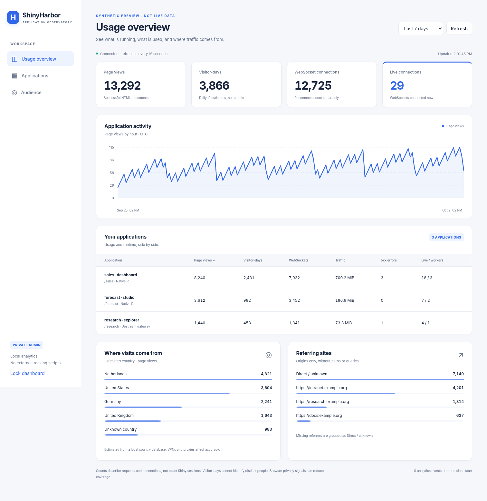

# ShinyHarbor


**Run your R Shiny apps on a computer that other people can visit in their web browser.**

ShinyHarbor starts your R apps, serves their pages, and provides a private usage
dashboard. It can also obtain and renew HTTPS certificates. You keep writing
ordinary Shiny code; your visitors only need a browser.

**Current version: 0.1.0-alpha.3, for evaluation.** This is **not a certified drop-in replacement**
for Posit's Shiny Server, and full Shiny Server Professional compatibility is not
complete. Windows x64 and Linux x64 have local validation; macOS and ARM installer
builds are pending. See [what has actually been tested](VALIDATION.md).

## Start here

1. [Choose your download](#choose-your-download).
2. Install on [Windows](#windows), [Debian or Ubuntu](#debian-and-ubuntu),
   [Fedora](#fedora), [Arch Linux](#arch-linux), [Alpine](#alpine-linux), or [macOS](#macos).
3. [Try the example, then add your own app](#add-your-own-shiny-app).
4. [Open the usage dashboard](#open-the-usage-dashboard).
5. [Manage server settings](#manage-server-settings) or try the [terminal monitor](#use-the-terminal-monitor).
6. When you are ready, [share apps with other people](#share-apps-with-other-people).

Also: [other Linux distributions](#other-linux-distributions) ·
[portable ZIP/tar downloads](#portable-downloads) ·
[CLI command guide](#cli-command-guide) · [updates and removal](#updates-backups-and-removal) ·
[troubleshooting](#troubleshooting) · [developer information](#for-developers).

## What you need

- **One computer to run the apps.** It can be your own computer for a first test,
  or a dedicated machine for longer-running use. It must stay on while people use
  your apps. This is the *server*.
- **R on that computer**, plus `shiny` and the R packages your apps use. RStudio is
  optional. The installers below explain how to get these dependencies.
- **An app folder** containing `app.R`, or `ui.R` and `server.R`, together with the
  files the app needs. The installer includes a small example to get you started.

The installer contains the ready-to-run ShinyHarbor program. You do not need to
compile Rust or install Cargo to use it.

ShinyHarbor initially accepts connections from **the server computer itself**.
The address `127.0.0.1` means “this computer.” Getting the example working locally
is the first step; making it available to other computers is a separate step below.
The initial setup uses **HTTP**, for example `http://127.0.0.1:3838/`. Changing
`http` to `https` in the browser does not enable encryption on the server. For
local HTTPS, follow [HTTPS on your own computer](#https-on-your-own-computer).

## Choose your download

Open [**GitHub Releases**](https://github.com/alekrutkowski/ShinyHarbor/releases/tag/v0.1.0-alpha.3)
and expand **Assets**. Choose an installer from this table. GitHub's automatically
generated **Source code** downloads contain source files, not an installer.

| Your computer | Download for this alpha | Availability |
| --- | --- | --- |
| Windows on Intel/AMD, 64-bit | [Windows setup `.exe`][windows-setup] | Available; see version-specific checks in [VALIDATION.md](VALIDATION.md) |
| Debian or Ubuntu, Intel/AMD 64-bit | [Debian/Ubuntu `.deb`][linux-deb] | Available; package and executable checked |
| Fedora, Intel/AMD 64-bit | [Fedora `.rpm`][linux-rpm] | Available; package and executable checked |
| Arch Linux, Intel/AMD 64-bit | [Arch `.pkg.tar.zst`][linux-arch] | Available; package and executable checked |
| Alpine 3.23 or newer, Intel/AMD 64-bit | [Alpine `.apk`][linux-apk] | Available; see Alpine validation below |
| macOS, Intel | `*-x86_64-apple-darwin.pkg` | Download pending |
| macOS, Apple Silicon (M-series) | `*-aarch64-apple-darwin.pkg` | Download pending |
| Windows ARM64 | `*-aarch64-pc-windows-msvc-setup.exe` | Download pending |
| Linux ARM64, including Arch Linux ARM | `.deb` with `arm64`, or `.rpm` / `.pkg.tar.zst` with `aarch64` | Downloads pending |

`x64`, `x86_64` and `amd64` mean the usual 64-bit Intel/AMD architecture. `ARM64`
and `aarch64` mean the 64-bit ARM architecture. On Windows, look at **Settings →
System → About → System type**. On a Mac, **Apple menu → About This Mac** shows an
Intel processor or an Apple chip. On Linux, `uname -m` prints the architecture.

Only the available files are attached to this prerelease. GitHub's account billing
block has prevented the remaining build jobs from starting. The Linux packages
have been inspected and their executables run, but a full installation on each
distribution has not yet been tested. The pending platforms have installer recipes
and release jobs prepared, not validated downloads.

The repository is currently private: sign in to a GitHub account with repository
access to download the files. Installing a local DEB/RPM/Arch/APK file does not add a
ShinyHarbor software repository or enable automatic updates.

## Windows

### Install and open the example

1. Install [R for Windows from CRAN](https://cran.r-project.org/bin/windows/base/)
   if it is not already installed. ShinyHarbor finds standard R installations
   without requiring you to edit PATH.
2. Download and double-click the [Windows setup installer][windows-setup].
3. Keep the default **all-users** installation and accept the Windows administrator
   prompt. This installs a persistent background service, enabled after reboot.
4. On **Application data**, choose a **local** folder for apps, settings, R packages
   and statistics. The default is `C:\ProgramData\ShinyHarbor`. Another local drive
   is fine; mapped network drives such as a network-backed Z: cannot be used by
   the LocalService account. Keep the same folder when upgrading.
5. Leave **Start automatically after reboot as a Windows service** selected.
   Setup installs Shiny into the server's private R library; this needs Internet access.
6. Finish setup. Open **Start menu → ShinyHarbor → Open applications**. The service
   is already running; no console window needs to stay open.
7. The start page shows an application card for **Sampling Lab**. Click it, then
   change an input: the plots and statistics update automatically.

For a temporary desktop test without administrator rights, choose **for your account**
instead. This explicit alternative has no background service: open **Start ShinyHarbor**
and keep its window open. Its default data directory is `%LOCALAPPDATA%\ShinyHarbor`.

The alpha installer is unsigned, so Windows may identify an unknown publisher.
Use the release checksums and your organisation's software-installation policy.

The Start menu also has **Application folders**, **Edit configuration**, and
**Usage dashboard** shortcuts. **Application folders** opens the exact place
where you will copy your own apps.

### Keep it running in the background

The default **all-users** installation selects **Start automatically after reboot
as a Windows service**. Keep that selection for an unattended server.
This requires administrator rights. A *service* is a program Windows starts and
keeps running in the background, including after a restart.

The service option installs its own Shiny library. Use local disks for the program
and data folders: a mapped/network Z: drive is available to your login session,
but generally not to the service. Use the ordinary Start shortcut for a network
drive. In **Services**, verify that its **Startup type** is **Automatic**. Installation does
not reboot your computer; checking boot registration is separate from a reboot test.

To stop or restart the service, open the Windows **Services** application, find
**ShinyHarbor**, and choose **Stop** or **Restart**. Stop a foreground copy before
starting the service so that they do not compete for the same port.

### Run diagnostic commands

Open **PowerShell**, not the R console. For the default all-users installation:

```powershell
$Harbor = "$env:ProgramFiles\ShinyHarbor\shinyharbor.exe"
& $Harbor --version
& $Harbor paths
& $Harbor doctor
```

If you chose another program folder, replace the first line with its full path,
for example `$Harbor = 'Z:\ShinyHarbor\shinyharbor.exe'`. An all-users installation
normally uses `C:\Program Files\ShinyHarbor\shinyharbor.exe`. A per-user installation
uses `$env:LOCALAPPDATA\Programs\ShinyHarbor\shinyharbor.exe`.
`paths` shows where your settings and R library are; `doctor` checks R and Shiny.
The installer does not add the program to PATH, so use its full path as above.

## Debian and Ubuntu

Download the [`.deb` package][linux-deb]. Open a **Terminal in the folder containing
the downloaded file**. For the current Intel/AMD 64-bit package, run:

```sh
sudo apt update
sudo apt install ./shinyharbor_0.1.0-alpha.3-1_amd64.deb
```

`sudo` asks for your Linux account password to allow system installation. The
package manager installs R and its packaged Shiny dependency too. Ubuntu systems
need access to the **Universe** package repository for `r-cran-shiny`; if APT cannot
find it, follow [Ubuntu's repository instructions](https://help.ubuntu.com/community/Repositories/Ubuntu).

ShinyHarbor installs a background service. Check it and open the example:

```sh
systemctl status shinyharbor --no-pager
sudo -u shinyharbor shinyharbor doctor --config /etc/shinyharbor/harbor.toml
```

On the same computer, visit <http://127.0.0.1:3838/hello/>.
Ubuntu-based distributions such as Linux Mint and Pop!_OS may use the DEB when
their repositories provide the listed dependencies; they are not separately
validated. Continue with [Linux folders and service controls](#linux-folders-and-service-controls).

## Fedora

Download the [`.rpm` package][linux-rpm]. Open a **Terminal in its download folder**:

```sh
sudo dnf install ./shinyharbor-0.1.0-alpha.3-1.x86_64.rpm
systemctl status shinyharbor --no-pager
sudo -u shinyharbor shinyharbor doctor --config /etc/shinyharbor/harbor.toml
```

DNF installs R and Fedora's `R-shiny` package. Open
<http://127.0.0.1:3838/hello/> on the server computer.
Continue with [Linux folders and service controls](#linux-folders-and-service-controls).

An RPM file is not automatically compatible with every RPM-based distribution.
For RHEL, Rocky Linux, AlmaLinux or openSUSE, use the
[other Linux guidance](#other-linux-distributions) until native packages for those
systems have been validated.

## Arch Linux

Download the [Arch package][linux-arch]. Open a **Terminal in its download folder**:

```sh
sudo pacman -Syu --needed r base-devel
sudo pacman -U ./shinyharbor-0.1.0_alpha.3-1-x86_64.pkg.tar.zst
```

The first command also updates the system's packages, following
[Arch's full-upgrade guidance](https://wiki.archlinux.org/title/System_maintenance#Partial_upgrades_are_unsupported).
Arch supplies R; install Shiny separately into the server's R library:

```sh
sudo -u shinyharbor shinyharbor setup --directory /etc/shinyharbor --install-shiny
sudo systemctl restart shinyharbor
sudo -u shinyharbor shinyharbor doctor --config /etc/shinyharbor/harbor.toml
```

The Shiny download may take several minutes because R packages can be compiled
from source. Open <http://127.0.0.1:3838/hello/> on the server computer.
There is currently no ShinyHarbor AUR entry. Arch Linux ARM needs a separate
`aarch64` build; do not install the `x86_64` package on it.

## Alpine Linux

Use **Alpine 3.23 or newer** (apk-tools 3); this alpha is tested in Alpine 3.24.2.
Download the [x86_64 APK][linux-apk]. ARM64 uses an `aarch64` APK when available.
Unlike Debian/Fedora/Arch, Alpine uses **OpenRC**, not systemd.

Run these commands in a **root shell** (`su -`, or `doas` if you already configured
it). First enable the **community** repository for your Alpine release in
`/etc/apk/repositories`, because that is where R is provided. Keep the same release
branch as `main`; do not mix stable and edge repositories. Then:

```sh
apk update
apk add --allow-untrusted ./shinyharbor-0.1.0_alpha3-r0-x86_64.apk
apk add R-dev build-base libuv-dev
su -s /bin/sh shinyharbor -c 'shinyharbor setup --directory /etc/shinyharbor --install-shiny'
rc-service shinyharbor status
rc-update show default
```

The local APK is unsigned; **verify its SHA-256 checksum from the release first**.
`--allow-untrusted` applies to this installation command and does not disable
signature checking globally. The APK installs R, OpenRC, log rotation and fonts for R plots, creates
the `shinyharbor` account and enables the service in the `default` boot runlevel.
It starts immediately when OpenRC is already running. The CRAN command above
installs Shiny once; R packages containing native code require the build tools.

Open <http://127.0.0.1:3838/> on the server computer. Configuration, apps, R library
and state use the [same locations as other Linux packages](#linux-folders-and-service-controls).
The service log is `/var/log/shinyharbor/service.log` and has a logrotate rule.

```sh
rc-service shinyharbor restart             # Apply ports/TLS changes
rc-service shinyharbor stop                # Stop until next start or reboot
rc-update del shinyharbor default          # Disable future automatic starts
rc-update add shinyharbor default          # Enable automatic starts again
shinyharbor admin-token --config /etc/shinyharbor/harbor.toml
shinyharbor tui --config /etc/shinyharbor/harbor.toml
```

The service runs as an unprivileged account. For public HTTPS on port 443, grant
only permission to bind low-numbered ports, then restart:

```sh
apk add libcap-utils
setcap cap_net_bind_service=+ep /usr/bin/shinyharbor
rc-service shinyharbor restart
```

Repeat `setcap` after replacing/upgrading the executable. Follow the common
[public HTTPS setup](#publish-at-your-own-https-address) for DNS, certificates
and firewall requirements. For local certificates, install `mkcert` and `nss-tools`
with `apk add` on the computer running your browser, then follow the Linux
certificate-copy instructions below. Do not put the local CA's signing key on a server.

In a container with no OpenRC boot process, installation still registers the service,
but run `shinyharbor serve --config /etc/shinyharbor/harbor.toml` as the container's
foreground process under the `shinyharbor` account. Boot autostart requires OpenRC
to be the operating system's service manager.

These instructions assume a normal installation on a persistent disk. Alpine's
diskless mode needs a persistent APK cache, saved system configuration and mounted
storage for your apps and state; follow Alpine's [diskless setup guide](https://wiki.alpinelinux.org/wiki/Diskless_Mode)
before relying on reboot persistence.

## Linux folders and service controls

These paths apply to the DEB, RPM, Arch and Alpine installers:

| What you want to find | Where it is |
| --- | --- |
| Your app folders | `/srv/shinyharbor/apps/` |
| Settings | `/etc/shinyharbor/harbor.toml` |
| R packages used by the server | `/var/lib/shinyharbor/R/library/` |
| Usage database, keys and saved state | `/var/lib/shinyharbor/` |

Use these commands in a Terminal:

```sh
sudo systemctl restart shinyharbor     # After changing server settings
sudo systemctl stop shinyharbor        # Stop serving apps
sudo systemctl start shinyharbor       # Start again
sudo journalctl -u shinyharbor -n 50 --no-pager  # Recent service messages
```

Debian/Ubuntu, Fedora and Arch packages use **systemd**, Linux's background-service manager.
Alpine uses the OpenRC commands above. A container without a service manager
should use [portable deployment](#portable-downloads)
or the [container instructions](docs/DEPLOYMENT.md#containers).

The packages install the distribution's R/Shiny versions, which can be older than
CRAN. If your app needs current CRAN Shiny, first install R package build tools
(`r-base-dev` and `libuv1-dev` on Debian/Ubuntu; `R-devel`, `gcc-c++`, `make` and
`libuv-devel` on Fedora), then run the same `setup --install-shiny` command shown
for Arch. This changes the private ShinyHarbor library; it does not upgrade R itself.

## macOS

**The macOS installers are not attached to this alpha yet.** These instructions
describe the prepared PKG; native macOS execution and signing remain pending.

1. In **Apple menu → About This Mac**, check Intel versus Apple Silicon.
2. Install the matching [R for macOS](https://cran.r-project.org/bin/macosx/).
3. Open the matching ShinyHarbor `.pkg` and approve installation. It registers a
   **system LaunchDaemon**, running as the dedicated `_shinyharbor` account.
   It starts at boot, before any desktop login, and restarts after a crash.
4. Open **Applications → ShinyHarbor → Install Shiny R package** and let it finish.
5. Open **ShinyHarbor.app** in that folder. It opens your configured application
   address. An administrator prompt is needed to read the protected configuration.

Configuration is `/etc/shinyharbor/harbor.toml`. Apps are in
`/Library/Application Support/ShinyHarbor/apps`; private state and R packages are
in the neighbouring `state` and `R/library` folders. These are system folders,
without `~` at the start. Use **Finder → Go → Go to Folder** to visit them.

The folder also includes dashboard, administration and terminal-monitor shortcuts.
Use **Restart server** after changing ports or TLS. **Stop background server**
stops and disables autostart; **Start ShinyHarbor** enables it again.

```sh
sudo /usr/local/bin/shinyharbor doctor --config /etc/shinyharbor/harbor.toml
sudo /usr/local/libexec/shinyharbor/daemon.sh status
sudo /usr/local/libexec/shinyharbor/daemon.sh restart
```

Existing per-user LaunchAgent installations must be stopped with
`/usr/local/libexec/shinyharbor/service.sh stop` before installing the system service.
Move your chosen apps and settings deliberately; the installer preserves the old
home-directory data and does not silently change its ownership or move it.

The PKG is unsigned and unnotarized. Follow your Mac's software-installation policy.

## Other Linux distributions

For openSUSE, RHEL-family systems, and other distributions, the portable
Linux archive is the evaluation route. These distributions are **not separately
validated**, and there are no native ShinyHarbor packages for them in this release.

1. Install R using the instructions for your distribution in
   [CRAN's Linux installation guides](https://cran.r-project.org/bin/linux/) or its
   distribution package manager. Install its R development/build tools if Shiny
   packages need compilation.
2. Download the [Linux x64 portable archive][linux-portable] for Intel/AMD 64-bit.
   It uses a static *musl* build: the server executable does not depend on a
   particular glibc version. R and its packages still need their own system libraries.
3. Follow the portable instructions below. Start it in the foreground first.
4. For unattended operation, use your system's service manager. The supplied
   [systemd service template](packaging/shinyharbor.service) is an example only for
   systems using systemd; follow [manual service setup](docs/DEPLOYMENT.md#linux-service).

There is no 32-bit release and no FreeBSD or other non-Linux Unix release in the
current build matrix.

## Portable downloads

Use this option to try the program without a system installer, or to keep it on
another drive. Download the [Windows ZIP][windows-portable] or
[Linux x64 tar archive][linux-portable] and extract **the entire archive** into a
writable folder. Keep the files together: the archive includes `harbor.toml`,
`apps/hello/app.R`, documentation and license notices.

On Windows, right-click the ZIP and select **Extract All**. On Linux, you can
extract from a Terminal in your download folder:

```sh
tar -xzf shinyharbor-0.1.0-alpha.3-x86_64-unknown-linux-musl.tar.gz
cd shinyharbor-0.1.0-alpha.3-x86_64-unknown-linux-musl
```

On Windows, open PowerShell in the extracted folder:

```powershell
.\shinyharbor.exe setup --directory . --install-shiny
.\shinyharbor.exe doctor --config .\harbor.toml
.\shinyharbor.exe serve --config .\harbor.toml
```

On Linux, open a Terminal in the extracted folder:

```sh
./shinyharbor setup --directory . --install-shiny
./shinyharbor doctor --config ./harbor.toml
./shinyharbor serve --config ./harbor.toml
```

Install R first. `setup` installs Shiny when requested and keeps existing settings.
The server stays in this terminal; **Ctrl+C** stops it. Open
<http://127.0.0.1:3838/hello/> to try it. A bare executable also finds the settings
beside it, even when launched from another working directory.

## Explore Sampling Lab

The example at `/hello/` is **Sampling Lab**, an interactive statistics lesson
using Shiny and base R. No plotting or statistics packages need to be installed.


1. The initial experiment runs when the app opens. The histogram is one random
   sample; the curve is its known population.
2. Change the population, sample size, mean, spread, confidence level, number of
   repetitions or seed. Results update automatically; there is no **Run experiment** button.
3. Open **Sampling distribution** to see estimates from repeated samples, or
   **Interval coverage** to see which confidence intervals contain the true mean.
   Try a skewed population with a small sample, then increase the sample size.
4. **Draw a new experiment** changes the random seed. It is optional: a fixed seed
   keeps comparisons reproducible. Each browser session has its own experiment.
5. Download the current sample, simulated intervals or a PDF plot report.

The lesson explains its assumptions and Monte Carlo uncertainty. Its live
updates and downloads also demonstrate ordinary Shiny functionality through
ShinyHarbor. Open the usage dashboard in another tab to observe the traffic.

Upgrading updates the bundled alpha.1 or alpha.2 example only when its `app.R` is still
unmodified, keeping a hidden backup. Your own edits are preserved. To install a
fresh copy elsewhere, use `shinyharbor example --directory /path/to/new-app`;
on Windows use `& $Harbor example --directory "C:\path\to\new-app"`.

## Add your own Shiny app

Start with an app that works in a fresh R session with `shiny::runApp("my-app")`.
Its code must load its own packages and data; objects left in your RStudio workspace
are not available to a new server R process.

1. Name the app folder something simple, such as `my-app`.
2. Copy the **whole folder**, including data files and `www` assets, into the apps
   folder for your installation. On Windows, use the **Application folders** shortcut.
3. The result should look like this, without an extra folder level:

   ```text
   apps/
     hello/
       app.R
     my-app/
       app.R
       www/
       data.csv
   ```

4. Install any additional R packages into a library the server can read; see below.
5. Visit <http://127.0.0.1:3838/my-app/>. The folder name becomes part of the address.
   The first visit may take longer while R starts. Newly added apps do not require
   a server restart.

For a Linux package installation, copy from the folder containing `my-app`:

```sh
sudo cp -R ./my-app /srv/shinyharbor/apps/
sudo chown -R root:shinyharbor /srv/shinyharbor/apps/my-app
sudo chmod -R u=rwX,g=rX,o= /srv/shinyharbor/apps/my-app
```

The last two commands make the copied app readable by the service while keeping
editing under administrator control. Apps that write files need a separate writable
location; see [deployment permissions](docs/DEPLOYMENT.md#linux-service).

### Install the R packages your app uses

ShinyHarbor does not infer your app's dependencies or copy your personal R library.
For example, if your app uses `ggplot2` and `dplyr`, install those for the server too.

On Windows or macOS, open a **fresh R session**. Set `lib` to the **R library** path
shown by `shinyharbor paths`, then run R code like this. The path below is an example;
replace it with yours. Forward slashes also work in Windows R paths.

```r
lib <- "Z:/ShinyHarborData/R/library"
dir.create(lib, recursive = TRUE, showWarnings = FALSE)
.libPaths(lib, include.site = FALSE)
install.packages(c("ggplot2", "dplyr"), lib = lib,
                 repos = "https://cloud.r-project.org")
```

Use an account allowed to write that library. For the Linux packages, run this
in a **Terminal**, replacing the package names as appropriate:

```sh
sudo -u shinyharbor env R_LIBS=/var/lib/shinyharbor/R/library R_LIBS_USER=/var/lib/shinyharbor/R/library R_LIBS_SITE= Rscript --vanilla -e 'install.packages(c("ggplot2", "dplyr"), lib="/var/lib/shinyharbor/R/library", repos="https://cloud.r-project.org")'
```

Some R packages need additional system libraries or compilers. Use the package's
installation instructions if R reports missing system dependencies. If your app
uses `renv`, restore its environment on the server using the same R version and
an account with access to that project; copying a library from another OS is not sufficient.

To apply edits to an existing app, create or update an empty `restart.txt` inside
its app folder. New visits start the updated app while existing sessions finish.
Restarting the whole server also applies edits, but interrupts active sessions.

## Open the usage dashboard

On the server computer, open <http://127.0.0.1:3839/> or use the Windows
**Usage dashboard** shortcut. The dashboard needs an *admin token*: a secret
that proves you administer this server.

Get it in a second terminal while the server is running:

| Installation | Command |
| --- | --- |
| Windows | `& $Harbor admin-token` after setting `$Harbor` as in the Windows section; use administrator PowerShell for an all-users service |
| Linux DEB/RPM/Arch | `sudo shinyharbor admin-token --config /etc/shinyharbor/harbor.toml` |
| macOS package | `sudo /usr/local/bin/shinyharbor admin-token --config /etc/shinyharbor/harbor.toml` |
| Alpine | As root: `shinyharbor admin-token --config /etc/shinyharbor/harbor.toml` |
| Portable | `./shinyharbor admin-token --config ./harbor.toml`; on Windows use `.\shinyharbor.exe` instead |

Paste the token into the dashboard's unlock field. Keep it private; it is not
an app-user password and should not be included in a shared link.



The dashboard shows app activity, traffic over time, connections and referring
sites. Country estimates require a separate country database; they are not
available automatically. See [analytics settings](docs/CONFIGURATION.md#analytics).
“Visitor-days” are daily estimates, not a count of unique people; reconnects can
increase connection counts. The analytics database does not store raw IP addresses,
but app code and other logs may record their own data. Analytics can be disabled.

## Manage server settings

On the server computer, open **<http://127.0.0.1:3839/admin>**. If you changed
`admin_listen`, use that port instead. The Windows installer also creates a
**Server administration** shortcut. The dashboard has a **Server settings** link.
This administration address is on the private dashboard port, not the public
app port. It continues to use **HTTP** when your apps use HTTPS.

Unlock it using the [same admin token as the dashboard](#open-the-usage-dashboard).
The token stays only in page memory. Refreshing or locking the page clears it.
Anyone with this token can read sensitive configuration and change how the
server runs, so keep it private.

- **Everyday settings** provides labelled controls and explanations for HTTPS,
  connection addresses, R, server data, statistics and transport limits.
- **Full configuration** edits every supported option, including app definitions,
  worker counts, access rules and legacy `shiny-server.conf` files. Use this for
  settings beyond the guided controls.
- **Running settings** shows all effective values, including defaults and
  resolved paths, with a search box. These are what the server is using now.
- **Settings reference** contains the complete bundled configuration guide and
  works without an Internet connection.

Change a setting, click **1. Validate changes**, review the result, then click
**2. Save and apply**. Validation does not change the file. Invalid settings or
unreadable/mismatched PEM certificate files are rejected. If another editor has
changed the file, refresh and reconcile your edits instead of overwriting them.

App routes and access rules can be applied live while existing sessions drain
normally. Ports, TLS, analytics and other global settings need a restart. The
button then says **Save for next restart**, and the page shows platform-specific
restart instructions. **Saved** does not mean **already active**. Configuration
changes do not move data directories or install missing R packages for you.

Each save puts a private backup in `.shinyharbor-backups` beside the configuration
file and replaces the file atomically. Backups may contain secrets. To undo a
change, copy the desired backup over `harbor.toml` locally, run `check`, then
reload or restart as appropriate. Old backups are retained until you remove
them; keep the ones you need, and include them in your disk-space planning.

The server account needs write access to the configuration file **and its parent
directory**. New Linux packages configure this for the `shinyharbor` account and
allow that directory through the systemd service's filesystem restrictions.
An existing manually deployed or locked-down service may be read-only; the page
will explain the write failure. Do not make the directory writable by everyone.
R app deployment remains a trusted operation: app code running as the server
account shares its filesystem permissions.

For remote administration, use the SSH tunnel below. Do not expose the admin
port through your firewall. There is no settings editor on the public app listener.

## Use the terminal monitor

Start ShinyHarbor as usual, then open a **second terminal** and run:

```sh
shinyharbor tui --config /path/to/harbor.toml
```

On Windows, use **Terminal monitor** (it asks for elevation for a service installation),
or open administrator PowerShell for the all-users service:

```powershell
& $Harbor tui --config "$env:ProgramData\ShinyHarbor\harbor.toml"
```

On packaged Linux, the service's private token belongs to its service account:

```sh
sudo -u shinyharbor shinyharbor tui --config /etc/shinyharbor/harbor.toml
```

The TUI is a live terminal interface showing server status, app workers and
connections. Use **Tab** or **1 / 2 / 3** to switch panels, **Up / Down** to scroll
apps, and **R** to refresh. **A** opens administration, **D** the usage dashboard,
and **O** the apps in a browser on desktop systems. On a headless server, use
the displayed addresses through an SSH tunnel on your own computer instead.
**Q**, **Esc**, or **Ctrl+C** closes the monitor; it does not stop the server.

For logs, scripts, or a terminal that cannot run an interactive interface:

```sh
shinyharbor tui --once --config /path/to/harbor.toml
shinyharbor open admin --print --config /path/to/harbor.toml
```

The first command prints a readable status snapshot. The second prints the
configured administration URL. `open apps` and `open dashboard` work similarly;
omit `--print` to open the browser. Installer shortcuts on Windows and macOS use
these commands so they follow your configured ports and HTTPS mode.

## CLI command guide

The **CLI** is the program you run in PowerShell or Terminal, not inside R/RStudio.
A *subcommand* selects an action; an *option* starts with `--` and modifies it.
For example, `shinyharbor tui --once` prints one status screen. Text such as `FILE`
below is a placeholder: replace it with your actual path, quoting paths with spaces.

On Windows replace `shinyharbor` with `& $Harbor`, after setting `$Harbor` to the
installed executable as shown in the Windows section. Installation does not add
it to PATH. On packaged Linux/macOS use an account with permission to read the
configuration; administration also needs access to the private state directory.
Use `sudo` on systemd Linux/macOS, or a root shell on Alpine, for those commands.

| Command and all its options | What it does and when to use it |
| --- | --- |
| `shinyharbor` | Starts with the discovered configuration. If none exists, creates a per-user example/config first. It does not install R or download Shiny automatically. |
| `shinyharbor FILE` | Starts with a named TOML or `shiny-server.conf` file; supports the original Shiny Server CLI style. |
| `shinyharbor --config FILE` or `-c FILE` | Another way to start with a specific file. Use either this or positional `FILE`. |
| `serve [-c FILE]` / `serve [--config FILE]` | Runs the server in the foreground. Ctrl+C stops it and drains sessions up to the configured shutdown timeout. A native service installer uses this automatically (Windows uses `service`). |
| `setup [--directory DIR] [--install-shiny]` | Creates first-run config, an example and a private R library in your chosen directory. Preserves existing configuration and custom apps. `--install-shiny` downloads Shiny from CRAN using already installed R; omit it to avoid downloads. Defaults to the per-user data directory. **Does not register a service**; use the native installer for that. |
| `init [DIR]` | Creates a portable workspace, defaulting to the current directory. Refuses to overwrite an existing `harbor.toml`. |
| `example [--directory DIR]` | Installs Sampling Lab in this app directory. Default: `apps/hello` under the per-user data directory. Updates only known unmodified old examples, with a backup; preserves customized apps. |
| `paths [-c FILE]` | Prints JSON showing the resolved config, R executable, R library, state and TLS file paths. Useful when you cannot find your installation. It prints paths, not credentials or key contents. |
| `check [-c FILE]` | Validates configuration without starting R or opening listening ports. Use before applying edits. Successful validation does not prove R packages or network ports are available. |
| `doctor [-c FILE]` | Validates settings and checks R/Shiny/package availability. Use first when an app does not start. |
| `reload [-c FILE]` | Asks the already running server to reload supported app routes/settings/access rules. Existing sessions continue. Changes to listeners, TLS and other fixed settings require a service restart instead. |
| `admin-token [-c FILE]` | Prints the secret that unlocks the dashboard and administration page. Keep it private; paste it into the page, not a URL. This does not start the server. |
| `hash-password` | Prompts twice for a password (at least 12 bytes), hides typing and prints an Argon2 hash for a local `[users]` entry. No password argument or plaintext file is required. |
| `open [PAGE] [-c FILE] [--print]` | Opens `apps`, `dashboard` or `admin` in your browser; defaults to `apps`. `--print` shows it without opening a browser, useful over SSH. This does not start the server. |
| `tui [-c FILE] [--once] [--width COLUMNS]` | Monitors an already running server. `--once` prints one snapshot. `--width` sets snapshot width from 40–240 columns, default 100. Interactive controls are explained above. Exiting the TUI leaves the server running. |
| `service --config FILE` | **Windows only:** entry point for Service Control Manager. The installer registers it; do not launch it manually in a console. It has no default config path. |
| `help [COMMAND]` or `COMMAND --help` | Explains a command. `-h` is the short help option. Top-level `--help` lists available public subcommands. |
| `--version` or `-V` | Prints the installed version. |

Every `[-c FILE]` in the table also accepts `--config FILE`. Place the option
**after** its subcommand: `shinyharbor tui --config FILE`. The top-level
`shinyharbor --config FILE tui` form is not supported. The hidden
`internal-log-writer --prefix PATH --mode MODE [--preserve]` command is solely an
internal worker logging helper; it is not an installation or administration command.

Typical sequence for an existing installation:

```sh
shinyharbor --version
shinyharbor check --config /path/to/harbor.toml
shinyharbor doctor --config /path/to/harbor.toml
shinyharbor serve --config /path/to/harbor.toml
# In a second terminal, while serve is running:
shinyharbor tui --once --config /path/to/harbor.toml
shinyharbor open apps --print --config /path/to/harbor.toml
```

For a service installation, use the OS service controls instead of starting a
second `serve` process on the same ports.

**Configuration discovery:** an explicit file wins. Otherwise ShinyHarbor checks
`SHINYHARBOR_CONFIG`, the current folder, the installer data pointer, files beside
the executable, the per-user data folder, and finally system configuration.
On Unix the final fallback includes `/etc/shiny-server/shiny-server.conf`.
Use an explicit `--config` for predictable service administration.
`RUST_LOG` controls diagnostic logging; `SHINY_LOG_LEVEL` is the simpler fallback
(`TRACE`, `DEBUG`, `INFO`, `WARN`, `ERROR`). `R` is the legacy default interpreter
override; config `rscript`/legacy `r_path` takes precedence. These environment
settings are optional; the config file is usually easier to manage.

If `tui` is missing from help or is treated as a filename, the executable is old.
Check the exact file with `--version`, close the old server, then install the
current release. For multiple copies, PowerShell's `Get-Command shinyharbor -All`
shows commands on PATH; installer shortcuts use an explicit executable path.

## HTTPS on your own computer

For a first local test, the supplied **HTTP** address is sufficient. If you want
to test HTTPS, you need a certificate for `localhost` and must tell ShinyHarbor
to use it. The certificate also needs to be trusted by your browser.
[Let's Encrypt cannot issue certificates for `localhost`](https://letsencrypt.org/docs/certificates-for-localhost/).
Its automatic certificate service is for a real domain, as described below.

These steps use [mkcert](https://github.com/FiloSottile/mkcert), a small tool for
local development certificates. This is an optional setup on **your own test
computer**, not the certificate setup to use for a public server.

1. Install mkcert for your operating system. These commands install the
   certificate tool; they do not yet make its certificates trusted.

   **Windows**, in PowerShell with WinGet:

   ```powershell
   winget install --exact --id FiloSottile.mkcert
   ```

   Close and reopen PowerShell if `mkcert` is not recognised afterwards.

   **macOS**, with [Homebrew](https://brew.sh/) already installed:

   ```sh
   brew install mkcert nss
   ```

   **Debian / Ubuntu**:

   ```sh
   sudo apt update
   sudo apt install mkcert libnss3-tools
   ```

   Ubuntu provides mkcert in its **Universe** repository. If apt cannot find it,
   enable that repository using the Ubuntu instructions linked earlier.

   **Fedora**:

   ```sh
   sudo dnf install mkcert nss-tools
   ```

   **Arch Linux** (perform a full upgrade, not a partial one):

   ```sh
   sudo pacman -Syu mkcert nss
   ```

   For another distribution, or a computer without these package managers, use
   [mkcert's official installation instructions and downloads](https://github.com/FiloSottile/mkcert#installation).
   The NSS tools help mkcert configure browsers that use an NSS certificate store.
2. Run the following command **only if you want to trust certificates issued by
   mkcert's local certificate authority on this computer**. It changes your
   certificate trust settings and may ask for administrator approval:

   ```sh
   mkcert -install
   ```

   Run this as your usual desktop account, not with `sudo` in front. mkcert will
   request elevated access if necessary. It must run on the computer **where
   the browser is used**. Installing trust on a remote server alone does not
   make your laptop trust its certificates. For a remote server, use the
   [public-domain HTTPS steps](#publish-at-your-own-https-address) or an SSH tunnel.

3. Generate the leaf certificate in the directory shown for your installation.
   For the Windows all-users service, open administrator PowerShell after trusting
   mkcert under the same Windows account:

   ```powershell
   Set-Location "$env:ProgramData\ShinyHarbor"
   New-Item -ItemType Directory -Path certs -Force
   mkcert -cert-file certs/localhost.pem -key-file certs/localhost-key.pem localhost 127.0.0.1 ::1
   ```

   **macOS system service**: generate the leaf certificate as your desktop user,
   then copy only the certificate and leaf key into the protected configuration folder:

   ```sh
   certwork=$(mktemp -d)
   mkcert -cert-file "$certwork/localhost.pem" -key-file "$certwork/localhost-key.pem" localhost 127.0.0.1 ::1
   sudo install -d -o root -g _shinyharbor -m 0750 /etc/shinyharbor/certs
   sudo install -o root -g _shinyharbor -m 0640 "$certwork/localhost.pem" /etc/shinyharbor/certs/localhost.pem
   sudo install -o root -g _shinyharbor -m 0640 "$certwork/localhost-key.pem" /etc/shinyharbor/certs/localhost-key.pem
   rm "$certwork/localhost.pem" "$certwork/localhost-key.pem"
   rmdir "$certwork"
   ```

   **Portable Linux**, after opening your chosen data folder (the default is
   `$HOME/.local/share/shinyharbor`):

   ```sh
   mkdir -p certs
   mkcert -cert-file certs/localhost.pem -key-file certs/localhost-key.pem localhost 127.0.0.1 ::1
   chmod 600 certs/localhost-key.pem
   ```

   **Packaged Debian / Ubuntu / Fedora / Arch / Alpine service**, on the same computer as
   your test browser (on Alpine, use `doas` instead of `sudo` after configuring it): generate files in your own private temporary folder, then
   install them where the service can read them. This does not copy the CA's
   signing key into the server directory.

   ```sh
   certwork=$(mktemp -d)
   mkcert -cert-file "$certwork/localhost.pem" -key-file "$certwork/localhost-key.pem" localhost 127.0.0.1 ::1
   sudo install -d -o root -g shinyharbor -m 0750 /etc/shinyharbor/certs
   sudo install -o root -g shinyharbor -m 0640 "$certwork/localhost.pem" /etc/shinyharbor/certs/localhost.pem
   sudo install -o root -g shinyharbor -m 0640 "$certwork/localhost-key.pem" /etc/shinyharbor/certs/localhost-key.pem
   rm -- "$certwork/localhost.pem" "$certwork/localhost-key.pem"
   rmdir -- "$certwork"
   ```

   On a **Windows background service**, LocalService also needs read access to
   the certificate and private key. The service installer grants read access
   to configured leaf files at service installation. If you add HTTPS later, applied a more restrictive ACL, or
   keep certificates elsewhere, grant that account read access to those files
   and their containing directory. Keep certificates and private keys outside
   every folder served as an app or static website. In administrator PowerShell,
   for the default certificate folder:

   ```powershell
   icacls "$env:ProgramData\ShinyHarbor\certs" /grant '*S-1-5-19:RX'
   icacls "$env:ProgramData\ShinyHarbor\certs\localhost.pem" /grant '*S-1-5-19:R'
   icacls "$env:ProgramData\ShinyHarbor\certs\localhost-key.pem" /grant '*S-1-5-19:R'
   ```

   `S-1-5-19` identifies LocalService on every Windows language edition. For a
   per-user installation, use its chosen data folder and skip those service ACL commands.
4. Back up `harbor.toml`. Replace its existing `[tls]` block with the following;
   do not add a second `[tls]` block:

   ```toml
   [tls]
   mode = "pem"
   cert = "certs/localhost.pem"
   key = "certs/localhost-key.pem"
   ```

   Alternatively, unlock **Server administration → Everyday settings → HTTPS
   certificates**, choose **Use certificate files (PEM)**, and enter these paths.
   Validate, then save. The page will explain that a restart is required.

   Keep the top-level `listen = "127.0.0.1:3838"` and `admin_listen` settings, or
   the custom ports you already chose. Certificate paths are relative to the
   configuration file. In a configuration with several `[[servers]]`, a server's
   own TLS setting can override this default; see [TLS settings](docs/CONFIGURATION.md#tls).
5. Save the file, run `check` using your executable and config path, then stop and
   start ShinyHarbor. For the default Windows installation:

   ```powershell
   $Harbor = "$env:ProgramFiles\ShinyHarbor\shinyharbor.exe"
   & $Harbor check --config "$env:ProgramData\ShinyHarbor\harbor.toml"
   ```

   If validation succeeds, press **Ctrl+C** in the running server's window and
   open **Start ShinyHarbor** again. For a background service, use the restart
   instructions for your platform above. Restarting disconnects active apps.

   On **packaged systemd Linux**:

   ```sh
   sudo -u shinyharbor shinyharbor check --config /etc/shinyharbor/harbor.toml
   sudo systemctl restart shinyharbor
   sudo systemctl status shinyharbor --no-pager
   ```

   On **macOS**:

   ```sh
   sudo /usr/local/bin/shinyharbor check --config /etc/shinyharbor/harbor.toml
   sudo /usr/local/libexec/shinyharbor/daemon.sh restart
   ```

   On **Alpine**, as root:

   ```sh
   shinyharbor check --config /etc/shinyharbor/harbor.toml
   rc-service shinyharbor restart
   rc-service shinyharbor status
   ```

   For **any portable installation**, Ctrl+C stops the foreground process;
   repeat your `shinyharbor serve --config ...` command to start it again.
6. Open **`https://localhost:3838/hello/`**, replacing `3838` if you chose a
   different app port. The app port now serves HTTPS. The **usage dashboard
   still uses HTTP** on its separate local port, normally
   `http://127.0.0.1:3839/`. Fully restart your browser if it has not picked up
   the new certificate trust settings.

   You should see Sampling Lab without a certificate warning. On Windows,
   `Invoke-WebRequest https://localhost:3838/hello/` also checks Windows trust;
   on Linux/macOS use `curl https://localhost:3838/hello/`. Replace the port as
   needed. Do not add an option that disables certificate verification.

   After changing your settings, `shinyharbor open apps --print` shows the
   configured app address. `shinyharbor open admin --print` shows the separate
   administration address. Add `--config /path/to/harbor.toml` for a custom file.

Certificates created by mkcert are not renewed automatically. Before the expiry
date it prints, rerun the certificate-generation command with the same filenames;
ShinyHarbor loads valid replacement files within five seconds. Keep mkcert's
`rootCA-key.pem` private and do not share it or commit it to Git. To return to
HTTP, restore `[tls]` to just `mode = "off"` and restart. To remove mkcert's local
certificate authority from the trust stores it manages, use `mkcert -uninstall`;
this also affects other local projects using that authority.

The public-domain ACME mode below **does** obtain and renew certificates
automatically. The local PEM mode above reloads files you replace; it does not
renew them for you. On packaged Linux, repeat both generation and `install`
commands when renewing so the service receives the new files and correct
permissions. Avoid deleting the ACME state directory during upgrades.

## Share apps with other people

An address beginning `127.0.0.1` only works on the computer where it is opened.
Sending that link to a colleague does not let them reach your server.

### Try a remote server privately

If you have SSH access to a Linux/macOS server, run this on **your own computer**,
replacing the account and server name:

```sh
ssh -L 3838:127.0.0.1:3838 -L 3839:127.0.0.1:3839 your-user@your-server
```

Keep that connection open. You can then use the example and dashboard addresses
above in your own browser. SSH carries the traffic securely; the server's default
local-only settings can stay in place. If you already run a local ShinyHarbor,
stop it first or use different local ports for the tunnel.

### Publish at your own HTTPS address

For an address such as `https://shiny.example.org/my-app/`, you need a domain name
pointing to the server and permission to accept incoming connections. If your
organisation manages domains or firewalls, give these steps to its IT administrator.

1. Point the domain's public DNS record to the server. Allow incoming **TCP 443**
   for HTTPS and **TCP 80** for the HTTP-to-HTTPS redirect. Forward those ports
   through a router if one sits in front of the server.
2. Open `harbor.toml`: use **Edit configuration** on Windows, the data folder on
   portable installs, or `/etc/shinyharbor/harbor.toml` on packaged Linux/macOS.
3. Change the existing top-level listener lines, near the beginning of the file:

   ```toml
   listen = "0.0.0.0:443"
   admin_listen = "127.0.0.1:3839"
   ```

4. Replace the existing `[tls]` block, or add this block before `[[sites]]` if there
   is no TLS block. Keep your existing app, state and R-library paths.

   ```toml
   [tls]
   mode = "acme"
   domains = ["shiny.example.org"]
   email = "you@example.org"
   production = false
   ```

5. Replace the domain and email with your real values, validate with
   `shinyharbor check --config /path/to/harbor.toml`, and restart the server using
   your platform's instructions above. On Windows, use `& $Harbor check --config`
   followed by the full config path in quotes.
6. `production = false` uses Let's Encrypt's **test** service. Its certificates
   are not trusted by browsers. After issuance succeeds in the server logs,
   change it to `production = true` and restart to request a trusted certificate.
7. Visit `https://your-real-domain/my-app/` and share that address.

The systemd Linux package's service can bind the required ports without running R as root.
Other Unix foreground installations may need an administrator to configure low-port
access or an existing reverse proxy; see [deployment](docs/DEPLOYMENT.md).
Certificate validation requires public port 443 to reach ShinyHarbor directly;
an HTTPS-terminating proxy/CDN cannot intercept that challenge. Wildcard domains
are not supported by this certificate setup. HTTPS configuration is implemented,
but public-CA production deployment has not been validated here.

ShinyHarbor renews certificates while it is running. Back up and retain its state
directory, including `acme`, so account keys and certificates survive upgrades.
The dashboard remains private; use the SSH tunnel for remote administration.

### HTTPS deployment details by platform

The `[tls]` configuration and certificate renewal behavior are the same on all
platforms. The surrounding service and firewall setup differs:

| Platform | Configuration and restart | What to check for public HTTPS |
| --- | --- | --- |
| Windows, foreground | Your selected data folder; stop the old process and use **Start ShinyHarbor** | Permit the ShinyHarbor executable through Windows Firewall on TCP 443 and 80. Use the actual installed executable path. |
| Windows service | Selected data folder, commonly `C:\ProgramData\ShinyHarbor`; `Restart-Service ShinyHarbor` in administrator PowerShell | The service uses LocalService, not your desktop account. It needs writable state for ACME and read access to PEM keys. |
| Debian / Ubuntu package | `/etc/shinyharbor/harbor.toml`; `sudo systemctl restart shinyharbor` | The supplied systemd unit allows binding ports 443/80. If UFW is enabled, allow `443/tcp` and `80/tcp`. |
| Fedora package | Same config and restart as above | If firewalld is enabled, allow its `https` and `http` services in the server's active zone, then reload firewalld. |
| Arch Linux package | Same config and restart as above | Use the rules for whichever firewall you installed; Arch does not mandate one firewall manager. |
| macOS package / system daemon | `/etc/shinyharbor/harbor.toml`; `sudo /usr/local/libexec/shinyharbor/daemon.sh restart` | Allow incoming connections in macOS Firewall settings. Runs as `_shinyharbor` at boot. Use an HTTPS reverse proxy on 443 if this account cannot bind the port. |
| Alpine / OpenRC | `/etc/shinyharbor/harbor.toml`; as root: `rc-service shinyharbor restart` | Runs as `shinyharbor`. For native port 443 use the capability setup in the Alpine section; configure your firewall separately. |
| Portable Linux/macOS | Your chosen file; stop and repeat `serve --config ...` | Configure your service manager, firewall and low-port access. The portable archive does not change them. |

For example, on **Ubuntu with UFW already enabled**, the public-app rules are:

```sh
sudo ufw allow 443/tcp
sudo ufw allow 80/tcp
```

On **Fedora with firewalld**, use the appropriate zone if your server does not
use the default one:

```sh
sudo firewall-cmd --permanent --add-service=https
sudo firewall-cmd --permanent --add-service=http
sudo firewall-cmd --reload
```

On **Windows**, an administrator can add a rule for the actual installed binary:

```powershell
$Harbor = "$env:LOCALAPPDATA\Programs\ShinyHarbor\shinyharbor.exe"
New-NetFirewallRule -DisplayName "ShinyHarbor public HTTPS" -Direction Inbound -Action Allow -Protocol TCP -LocalPort 80,443 -Program $Harbor
```

Change `$Harbor` for an all-users or custom installation. These are publishing
steps: do not open the dashboard/admin port. Your router or cloud firewall may
also need rules; a local firewall rule alone does not configure those.

If a Unix/macOS account cannot bind port 443, keep R running as an ordinary
account. An administrator can forward public TCP 443 to a higher local port,
such as 8443, **without terminating TLS**. With that forwarding in place, use
`listen = "0.0.0.0:8443"`, `http_redirect_listen = "0.0.0.0:8080"` and
`public_origin = "https://your-real-domain"` as top-level settings, and forward
public TCP 80 to local 8080. Keep the ACME block above. Let's Encrypt still
connects to **public port 443**; just changing the local port without forwarding
will not work. Alternatively, let a trusted reverse proxy manage public TLS;
see [proxy configuration](examples/proxy-tls.toml).

After restarting, open your real HTTPS domain from another computer. Verify that
the browser accepts its certificate and that Sampling Lab runs an experiment.
If issuance fails, inspect the server/service log and check domain DNS, both
IPv4/IPv6 routes when present, the public port, and certificate-state permissions.
Do not disable certificate checks to turn a failed test into a successful one.

**HTTPS encrypts traffic; it does not decide who may use an app.** Apps are
accessible without a login by default. For private apps, configure
[password protection](docs/CONFIGURATION.md#password-protection) or
[your organisation's sign-in proxy](docs/CONFIGURATION.md#authentication-proxies-and-groups)
before exposing them. ShinyHarbor does not open your firewall automatically.

## Updates, backups and removal

Before updating, back up your app folders, `harbor.toml`, private R library and
state directory. For a consistent copy of the usage database, stop the server
while taking the backup. Keep state backups private because they contain keys.

| Platform | Update | Remove the program |
| --- | --- | --- |
| Windows | Run the newer setup installer, keeping the same folders | Settings → Apps → ShinyHarbor → Uninstall |
| Debian/Ubuntu | `sudo apt install ./NEW-PACKAGE.deb` | `sudo apt remove shinyharbor` |
| Fedora | `sudo dnf upgrade ./NEW-PACKAGE.rpm` | `sudo dnf remove shinyharbor` |
| Arch | `sudo pacman -U ./NEW-PACKAGE.pkg.tar.zst` | `sudo pacman -R shinyharbor` |
| Alpine | As root: `apk add --allow-untrusted ./NEW-FILE.apk` | `apk del shinyharbor` (preserves app data) |
| macOS, when available | Run the newer PKG | Applications → ShinyHarbor → Uninstall ShinyHarbor |
| Portable | Stop the server; unpack the new release into a separate folder and point it at your existing config | Remove the program folder only after separating/backing up your app data |

Replace `NEW-PACKAGE` with the actual downloaded filename. Native installers keep
your apps and settings during upgrades, and retain data when the program is removed.
Linux package-manager *purge* can remove configuration. Portable archives contain
a sample configuration: do not overwrite your working `harbor.toml` with it.

## Troubleshooting

| What you see | What to do |
| --- | --- |
| GitHub download says “404” | Sign in with an account that has access to this private repository. Check that the table lists the file as available. |
| `shinyharbor` is not recognised | On Windows use the Start menu shortcut or the full executable path with `&` in PowerShell. For an extracted archive use `./shinyharbor` or `.\shinyharbor.exe`. |
| “Cannot find configuration” / old “os error 2” | Extract the entire current archive or use the installer. For a standalone binary, run `setup --directory "YOUR-DATA-FOLDER"`, then `serve --config "YOUR-DATA-FOLDER/harbor.toml"`. Very old builds use `init` instead of `setup`. |
| “Cannot start R” | Install R on the server and run `doctor`. If R is in a custom location, set `rscript` in `harbor.toml`; see [configuration](docs/CONFIGURATION.md). |
| R says there is no package called `shiny` | Select the install-Shiny option, or run `setup --directory "YOUR-DATA-FOLDER" --install-shiny`. For a Linux package use `/etc/shinyharbor` as that directory and run as the `shinyharbor` account. |
| Your app cannot find another package | Install it into the server's R library. A Windows service or Linux service does not use your RStudio account's personal library. |
| The example works, but your app does not | Run the app in a fresh R session, check its data paths, and inspect its worker log in the state directory's `logs` subfolder. Use paths relative to the app folder instead of your own desktop. |
| “Address already in use” | Check whether another ShinyHarbor or Shiny Server is already running. Stop the duplicate, or select unused app/dashboard ports in `harbor.toml`. |
| A colleague cannot open your link | `127.0.0.1` is local to each computer. Follow the sharing instructions; check the server is on and its domain/firewall settings are correct. |
| `ERR_SSL_PROTOCOL_ERROR` / “localhost sent an invalid response” | You may be opening `https://` on a port that serves HTTP. The default `[tls]` mode is `off`: use the supplied `http://` app address, or follow [local HTTPS setup](#https-on-your-own-computer). The dashboard uses HTTP on its own port even when app HTTPS is enabled. |
| Local HTTPS says the certificate is not trusted | The server is now speaking TLS, but your browser does not trust its certificate. Follow the mkcert trust step, restart the browser, and use a hostname listed in the certificate. Do not disable certificate verification. |
| Browser certificate warning with test HTTPS | `production = false` creates a test certificate. Complete the HTTPS steps and switch to production; do not send users the staging-certificate endpoint. |

`check` validates configuration; `doctor` checks R and Shiny. Neither command
checks every package your app needs. For further help, include your OS, the result
of `shinyharbor --version`, the relevant error, and what command you ran. Remove
admin tokens, passwords and private app data before sharing logs.

<details>
<summary>Optional: verify a downloaded file's checksum</summary>

A checksum detects a damaged or changed download. Download the matching `.sha256`
file from the same release and compare its long hexadecimal value with your result.
It does not replace a trusted publisher signature.

Windows PowerShell, using the actual downloaded filename:

```powershell
Get-FileHash .\shinyharbor-0.1.0-alpha.3-x86_64-pc-windows-msvc-setup.exe -Algorithm SHA256
```

Linux, with the installer and its sidecar in the same directory:

```sh
sha256sum -c shinyharbor_0.1.0-alpha.3-1_amd64.deb.sha256
```

On macOS, use `shasum -a 256 FILE` and compare the value. `SHA256SUMS` on the release
lists only the files actually published in that release.

</details>

## Existing Posit Shiny Server installations

Keep your existing service intact while evaluating ShinyHarbor. It understands a
documented subset of `shiny-server.conf`, but unsupported directives fail rather
than being silently ignored, and runtime/Professional parity remains incomplete.
For a test, copy the configuration, use different listening ports and a separate
state directory, then run `shinyharbor check --config COPY.conf` before starting it.
See the [compatibility guide](docs/COMPATIBILITY.md) for the outstanding differences.

ShinyHarbor can also forward requests to an independently running Shiny Server.
That mode still depends on the original server and its limitations; see
[upstream configuration](docs/CONFIGURATION.md#upstream).

## For developers

The server is written in Rust, using Tokio and axum/hyper for HTTP, rustls/ACME for
TLS, and SQLite for usage summaries. R processes start on demand, can use
configurable per-app pools, and stop when idle. Increasing worker limits can run
more R processes; it does not make a single R computation faster or make app code
safe to run from untrusted authors.

The build matrix targets Windows, macOS, and Linux (GNU/musl), each on x64 and ARM64.
Local tests used R 4.6.1 and Shiny 1.14.0. The exact executed tests, limitations and
pending platforms are recorded in [VALIDATION.md](VALIDATION.md). Full compatibility
and stable releases remain gated by the [conformance inventory](conformance/required.json).

To build from source, install current stable Rust and your platform's C/C++ build
tools (Microsoft C++ Build Tools on Windows), then run:

```sh
cargo build --locked --release
```

The executable is `target/release/shinyharbor`, or `target\release\shinyharbor.exe`
on Windows. Install R separately and follow the portable setup instructions using
that executable. Building from source can consume several gigabytes of disk space.

Further documentation:

- [Installation reference](docs/INSTALLATION.md), including silent setup and custom paths.
- [Configuration reference](docs/CONFIGURATION.md), including worker pools, authentication and analytics.
- [Deployment](docs/DEPLOYMENT.md) and [operations](docs/OPERATIONS.md).
- [Compatibility](docs/COMPATIBILITY.md), [security](SECURITY.md), and [validation](VALIDATION.md).
- [CI and release process](docs/RELEASING.md).

License: MIT, copyright Alek Rutkowski. Bundled dependency notices accompany the
downloads; external-runtime acknowledgments are in [ATTRIBUTIONS.md](ATTRIBUTIONS.md).

[windows-setup]: https://github.com/alekrutkowski/ShinyHarbor/releases/download/v0.1.0-alpha.3/shinyharbor-0.1.0-alpha.3-x86_64-pc-windows-msvc-setup.exe
[linux-deb]: https://github.com/alekrutkowski/ShinyHarbor/releases/download/v0.1.0-alpha.3/shinyharbor_0.1.0-alpha.3-1_amd64.deb
[linux-rpm]: https://github.com/alekrutkowski/ShinyHarbor/releases/download/v0.1.0-alpha.3/shinyharbor-0.1.0-alpha.3-1.x86_64.rpm
[linux-arch]: https://github.com/alekrutkowski/ShinyHarbor/releases/download/v0.1.0-alpha.3/shinyharbor-0.1.0_alpha.3-1-x86_64.pkg.tar.zst
[windows-portable]: https://github.com/alekrutkowski/ShinyHarbor/releases/download/v0.1.0-alpha.3/shinyharbor-0.1.0-alpha.3-x86_64-pc-windows-msvc.zip
[linux-portable]: https://github.com/alekrutkowski/ShinyHarbor/releases/download/v0.1.0-alpha.3/shinyharbor-0.1.0-alpha.3-x86_64-unknown-linux-musl.tar.gz

[linux-apk]: https://github.com/alekrutkowski/ShinyHarbor/releases/download/v0.1.0-alpha.3/shinyharbor-0.1.0_alpha3-r0-x86_64.apk
